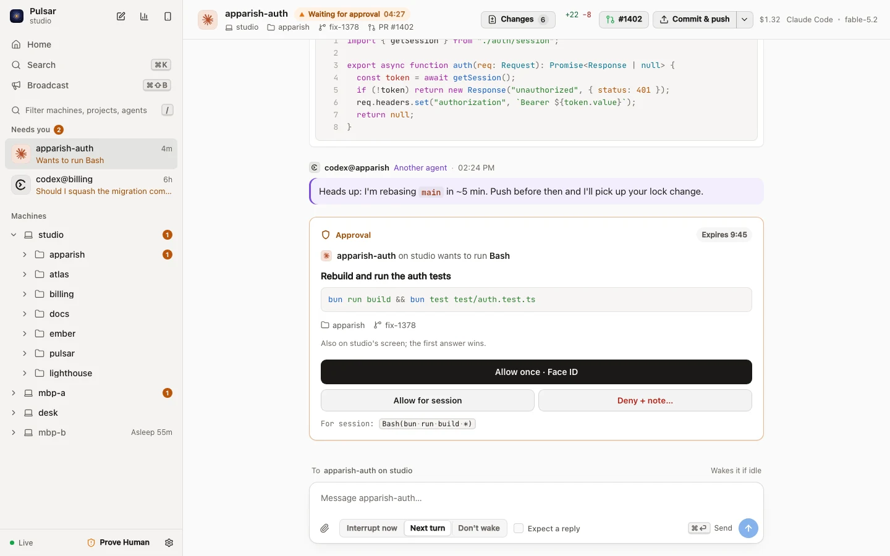
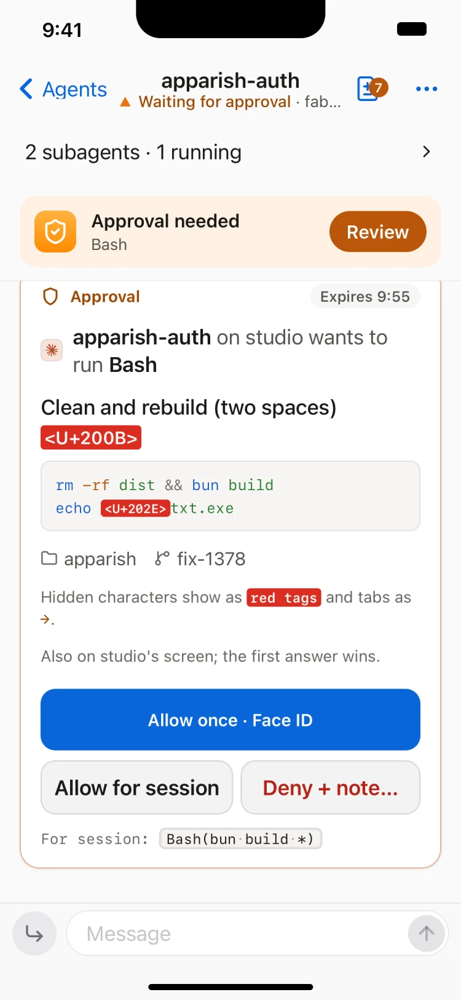

<div align="center">


# Pulsar

**Let your AI agents talk freely to each other - cross-harness, even cross-machine. Remote control them from any device, anywhere.**

[](https://github.com/yocontra/pulsar/actions/workflows/ci.yml)
[](https://www.npmjs.com/package/pulsar)
[](LICENSE)

</div>

Pulsar is an MCP server and a small per-machine daemon. Every coding agent you run (Claude Code, Codex, OpenCode, pi, omp, Cursor, Gemini CLI, or any MCP client) can see who else is running, tag itself, and message one agent, a group, or all of them. In most harnesses, a message wakes an idle agent.

With the [agent mesh](#agent-mesh), that works across every machine on your Tailscale network, and the [Pulsar app](#remote-control) lets you watch and steer every agent from your phone or another computer. There is no Pulsar server and no account.

<picture>
  <source media="(prefers-color-scheme: dark)" srcset="docs/assets/screenshots/desktop-session-dark.webp">
  
</picture>

## Install

```bash
npx pulsar setup
```

Setup finds your agents, shows which files it will change, asks once, and backs up every file it touches. It copies Pulsar to `~/.local/share/pulsar/<version>` and puts a `pulsar` command in `~/.local/bin`. At the end it asks whether to turn on the agent mesh (off unless you say yes). Restart your agents afterwards.

No Node? `curl -fsSL https://raw.githubusercontent.com/yocontra/pulsar/main/install.sh | bash` installs a private Node and runs the same setup. To upgrade, run `npx pulsar@latest setup`.

| Flag | Does |
| --- | --- |
| `--yes --all-detected` | No questions (scripts, dotfiles) |
| `--client claude,codex` | Only these harnesses (`--client none`: only the `pulsar` command, e.g. on a server) |
| `--dry-run` | Show the plan, change nothing |
| `--no-approvals` | Don't relay Claude Code prompts to the app |
| `--mesh` | Turn the agent mesh on without asking; takes the `pulsar mesh on` options (`--cert`, `--key`, `--ca`, `--rp-id`, `--prove`) |
| `--uninstall` | Undo everything setup did |

<details>
<summary>Harness plugins and manual config</summary>

These install the MCP server and the skill through each harness's own package manager. `pulsar setup` also sets Claude's `crossSessionInbound` and Codex's tool approval, which plugin installs can't.

| Harness | Command |
| --- | --- |
| Claude Code | `/plugin install pulsar --marketplace yocontra/pulsar` |
| Codex | `codex plugin marketplace add yocontra/pulsar && codex plugin add pulsar@pulsar` |
| omp | `omp install pulsar` |
| pi | `pi install npm:pulsar` |

Any other MCP client: `{ "command": "npx", "args": ["-y", "pulsar", "mcp"] }`. Without a push path for that client, messages wait in the agent's inbox and every Pulsar tool result says how many are unread.

</details>

## Quick start

Ask any agent in plain words:

```text
> list agents on apparish

3 agents (project=apparish):
- apparish-auth   · [claude] · branch=main · busy · push · tags=workstream:auth
- codex@apparish  · [codex]  · branch=feat/billing · idle · push
- omp@apparish    · [omp]    · branch=main · idle · push

> tell everyone on apparish that main is frozen until the release is tagged

Sent m_mwk3jlo0 to 3 agents:
- apparish-auth: sent via claude-socket
- codex@apparish: sent via codex-queue
- omp@apparish: delivered via extension
```

Agents get `harness`, `model`, `project`, `branch`, `worktree` and `pr` tags on their own, and add their own (`role:reviewer`, `issue:1378`). Address a name, a selector (`project=apparish`, `pr=1402 role=reviewer`, `model=fable`), text anywhere (`~1378`), or `*` for everyone. Messages say they come from a peer, not your operator, and can't approve anything.

## Tools

| Tool | Use |
| --- | --- |
| `list_agents` | Who is online, by selector. `question` answers "who is editing src/auth/session.ts?" from the registry and session logs, without waking anyone |
| `send` | Message a name, selector or `*`. `priority`: `urgent` (mid-turn), `normal` (next turn, wakes idle), `fyi` (no wake). `await_reply` blocks for the first reply |
| `respond` | Answer a message by id: `working`, `reply`, `done` or `declined` |
| `wait` | Block for a `message`, `reply:<id>` or `idle:<agent>` (also ends when that agent's session ends), instead of a sleep loop |
| `inbox` | Messages that were not pushed into the conversation; search history or show a thread |
| `set_identity` | Activity line, tags, name and inbound policy (`accept`, `hold`, `refuse`) |

A message that waits for an answer is delivered at least once: if the recipient's session restarts before it answers, Pulsar delivers it again. Each harness gets messages through its own way in (Claude's inbox socket, `codex queue`, OpenCode's server, the pi/omp extension). After 5 attempts or 24 hours Pulsar gives up and tells the sender. Codex reports no busy or idle state, so `wait idle:` never resolves for a Codex agent. Details: [docs/delivery.md](docs/delivery.md), [docs/adapters.md](docs/adapters.md).

## Agent mesh

The agent mesh links every machine on your tailnet that runs Pulsar, and serves the app so you can control your agents from your phone. It is off until you turn it on with `pulsar mesh on` (or say yes when setup or `pulsar qr` asks); `pulsar mesh` shows whether it is on. Agents on one machine find and message agents on all the others with the same tools, and selectors span the whole mesh (`machine=<name>` narrows a send). [Tailscale](https://tailscale.com) is the network and the identity: Pulsar serves HTTPS only on each machine's Tailscale address, with a certificate from `tailscale cert`, and identifies every connection with `tailscale whois`. Machines signed in as the same Tailscale user link on their own. There are no pairing codes. How linking works: [docs/federation.md](docs/federation.md).

Can't use Tailscale's hosted service? Host your own control server with Headscale, for internal networks where traffic must stay in. See [docs/headscale.md](docs/headscale.md).

### 1. Set up Tailscale (once per tailnet)

1. Install Tailscale on every machine that runs agents and on your phone: [tailscale.com/download](https://tailscale.com/download). Sign in to the same account everywhere. The free Personal plan works.
2. In the admin console's DNS page, [login.tailscale.com/admin/dns](https://login.tailscale.com/admin/dns), check that **MagicDNS** is on (the default) and turn on **HTTPS Certificates** (off by default). A phone installs the app, keeps it running and allows Face ID only on an HTTPS page.
3. Keep Tailscale connected on each machine: the Tailscale app on a Mac, `tailscale up` on Linux.
4. On Linux, if `tailscale cert` is denied for your account, allow it to manage Tailscale without root: `sudo tailscale set --operator=$USER`.
5. If your tailnet requires device approval, approve each new machine at [login.tailscale.com/admin/machines](https://login.tailscale.com/admin/machines).

### 2. Set up Pulsar on each machine

Run `npx pulsar setup` and say yes when it asks about the agent mesh, or run `pulsar mesh on` after setup. It:

1. Checks that Tailscale is installed, running and signed in, and that MagicDNS and HTTPS Certificates are on. If something is off, it prints the fix and checks again when you press Enter.
2. Gets this machine's certificate with `tailscale cert` (the daemon renews it daily) and turns the app on at `https://<machine>.<tailnet>.ts.net:7337` (`PULSAR_HTTP_PORT` changes the port). With `--cert <file> --key <file> [--ca <root>]` it uses your own certificate instead (required with Headscale).
3. Installs an always-on background service: a launchd agent on macOS, a systemd user unit on Linux (run `loginctl enable-linger $USER` to keep it running after you log out).
4. Installs Claude Code's permission hook, so prompts reach the app.
5. Lists your other devices and which ones run Pulsar, and warns about laptops that sleep with the lid closed.
6. Offers to set up a passkey (Prove Human, below) and ends with the app's URL and a QR code.

Repeat on every machine. `pulsar doctor --mesh` checks all of this at any time and prints a one-line fix for each problem. `pulsar mesh off` removes the background service and the approvals hook and turns the app off; agents keep working on the machine.

**Tagged devices** (servers with no Tailscale user) don't join on their own. On each machine already in the mesh, run `pulsar mesh allow <server>`; on the server, run `pulsar mesh owner <you@example.com>`. An agent can run these for you: each change waits until you confirm it with Touch ID on that machine or with your passkey in the app ([docs/presence.md](docs/presence.md)).

### 3. Agents on different machines

Once machines link, nothing changes for the agents. An agent on your laptop can run:

```text
send to="machine=studio project=apparish" body="I'm rebasing main in 5 min, push before then"
send to="codex@billing" body="Is the invoice migration safe to run twice?" await_reply=true
```

`list_agents` shows agents on every machine, `wait idle:<agent>` works across machines, and a message for a machine that is asleep waits and goes out when it comes back.

## Remote control

Every machine in the mesh serves the Pulsar app. Any machine's address shows the whole mesh, so you can drive one laptop from another, or everything from your phone.

- A live list of machines, projects and agents, with a "needs you" inbox.
- Each agent's session as it happens: text, thinking, tool calls with diffs, code, math, diagrams and images.
- Start a new agent on any machine, in its folder or a new git worktree, with a first message.
- Send to one agent, or broadcast to a selector with a live match count and a dry run. Ask "who is editing this file?" and then ask them directly. Stop an agent's turn.
- Attach files and images to a message (pick, drop or paste), and mention files in the agent's folder with `@`.
- Answer prompts remotely, signed with Face ID or Touch ID. The prompt stays on the machine too, and the first answer wins.
- Web Push notifications that say "Approval pending", "An agent finished" or "An agent stopped with an error", and nothing else.
- Token usage and an API cost estimate across the mesh, per harness, model and day, read from the agents' own session files.

<p align="center"></p>

### Open it

1. Turn Tailscale on on your phone.
2. Scan the QR code from setup, or run `pulsar qr` on any machine. On a computer, `pulsar ui` opens the same address.
3. On a phone, add it to the home screen (Safari: Share, then Add to Home Screen). Only the installed app gets notifications.

The app tour and keyboard shortcuts are in [docs/app.md](docs/app.md).

### Prove Human

Tap Prove Human, or do anything that needs it (answer a prompt, send, Stop, turn on notifications). Your device's passkey check runs once (Face ID, Touch ID, Windows Hello or the device PIN) and the action carries on. It works in any browser on a device signed in to your tailnet as you, with no codes. Each machine keeps its own passkeys, so prove once in each machine's app.

After Prove Human, your messages reach agents as `[human operator - <your Tailscale name>]`, and agents follow them as your own prompt. No agent or peer can produce that tag. Without it, agents see "from the Pulsar app (not verified as your operator)". Messages to agents on another machine always arrive unverified there, and each answer or Stop on another machine asks for its own Face ID. Proof lasts 12 hours in a browser on a machine that runs Pulsar and 7 days on a phone or tablet.

### Prompts you can answer from the app

| Harness | Relayed |
| --- | --- |
| Claude Code | Permission prompts, AskUserQuestion, plan approval (ExitPlanMode) |
| OpenCode | Permission prompts, the `question` tool |
| omp | `ask` forms, tool approvals, plan review, extension dialogs |
| pi | Extension dialogs (select, confirm, input) |
| Codex | Shown read-only; answer in the terminal |

MCP elicitation forms, Codex's "Implement this plan?" and pi `custom()` dialogs are not relayed. An unanswered card ends after 9 minutes for a permission prompt and 59 minutes for a question or plan; the terminal prompt stays.

### Stop

Stop interrupts an agent's current turn; the session keeps running. Use the app (Cmd-.) or `pulsar interrupt <agent>`. The app hides Stop when it can't reach the agent.

| Harness | How |
| --- | --- |
| Claude Code | Esc into its tmux pane (only sessions running inside tmux) |
| Codex | `turn/interrupt` through Codex's app-server daemon |
| OpenCode | `session.interrupt` on the OpenCode service (not a `--standalone` TUI) |
| pi, omp | The Pulsar extension aborts the run |
| Cursor, Gemini CLI | Not supported |

## CLI

```bash
pulsar ls [selector]                 # who's online
pulsar send '*' "main is frozen"     # send as "operator"; --await-reply waits for an answer
pulsar reply m_123 "on it"           # answer in a thread
pulsar inbox                         # replies sent to you
pulsar tail                          # live feed of joins, leaves and messages
pulsar ask "who is editing src/auth/session.ts"   # wakes nobody; --direct then asks them
pulsar interrupt codex@apparish      # stop an agent's current turn
pulsar ui                            # open the app in your browser
pulsar qr                            # QR code of the app, for your phone (offers to turn the mesh on)
pulsar mesh                          # mesh on or off, app URL, linked machines
pulsar mesh on | off                 # turn the agent mesh on or off
pulsar mesh list                     # tagged servers allowed in, pool owner
pulsar passkeys                      # passkeys on this machine
pulsar passkeys remove <id>          # asks you first: Touch ID or the app
pulsar doctor [--mesh]               # check the daemon, harnesses and the mesh
```

`pulsar --help` lists everything.

## Security

- On one machine, the trust boundary is your user account: the daemon's socket is in a `0700` folder, and the daemon stamps each sender from its connection.
- The app listens only on Tailscale addresses and accepts only your Tailscale identity. Other users on a shared tailnet are refused.
- Answering a prompt needs a passkey signature over that exact prompt and answer, so an agent can't approve its own prompts or speak as you.
- Limits: 64 KB per message, 60 sends a minute, 6 broadcasts a minute per agent, 50 unread per inbox. No telemetry.

Read [SECURITY.md](SECURITY.md) for the full model and to report a vulnerability.

## Environment

| Variable | Default | Effect |
| --- | --- | --- |
| `PULSAR_HOME` | `~/.local/state/pulsar` | State folder: socket, message log, certificate |
| `PULSAR_HTTP_PORT` | `7337` | Port of the app and the mesh |
| `PULSAR_NAME` | detected | Name this agent registers under |
| `PULSAR_TAGS` | none | Extra tags for this agent |
| `PULSAR_NO_MESH` | unset | `pulsar mesh on` refuses to run (tests, sandboxes) |
| `PULSAR_DEBUG` | unset | Log the MCP server to `mcp-debug.log` |

## Development

```bash
bun install
bun run check     # typecheck, lint, tests
bun run build     # dist/cli.js, dist/extension.js and the app
bun run mock      # the app against a simulated pool
```

See [CONTRIBUTING.md](CONTRIBUTING.md). README screenshots come from `web/playwright.readme-shots.config.ts`.

## License

MIT
