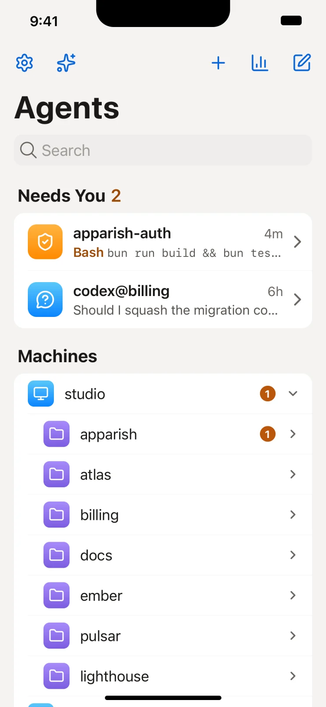

<div align="center">


# Pulsar

**Let your AI agents talk to each other, across harnesses and machines. Control them from any device.**

[](https://github.com/yocontra/pulsar/actions/workflows/ci.yml)
[](https://www.npmjs.com/package/pulsar)
[](LICENSE)

</div>

Pulsar connects the coding agents you already run: Claude Code, Codex, OpenCode, pi, omp, Cursor, Gemini CLI, or any MCP client. Each agent can see who else is running and message one agent, a group, or all of them. A message wakes an idle agent in most harnesses.

Turn on the agent mesh and this works across all your machines. The Pulsar app lets you watch and steer every agent from your phone or another computer. There is no Pulsar server and no account.

<picture>
  <source media="(prefers-color-scheme: dark)" srcset="docs/assets/screenshots/desktop-session-dark.webp">
  
</picture>

## Install

```bash
npx pulsar setup
```

Setup finds your agents, shows what it will change, and backs up every file it touches. Restart your agents afterwards. To upgrade, run `npx pulsar@latest setup`. To remove everything, run `npx pulsar setup --uninstall`.

No Node? Run `curl -fsSL https://raw.githubusercontent.com/yocontra/pulsar/main/install.sh | bash`.

<details>
<summary>Harness plugins and other MCP clients</summary>

| Harness | Command |
| --- | --- |
| Claude Code | `/plugin install pulsar --marketplace yocontra/pulsar` |
| Codex | `codex plugin marketplace add yocontra/pulsar && codex plugin add pulsar@pulsar` |
| omp | `omp install pulsar` |
| pi | `pi install npm:pulsar` |

Any other MCP client: `{ "command": "npx", "args": ["-y", "pulsar", "mcp"] }`. `pulsar setup` also sets a few harness options that plugin installs can't. See [docs/adapters.md](docs/adapters.md).

</details>

## Use it

Ask any agent in plain words:

```text
> list agents on apparish

3 agents (project=apparish):
- apparish-auth   · [claude] · branch=main · busy
- codex@apparish  · [codex]  · branch=feat/billing · idle
- omp@apparish    · [omp]    · branch=main · idle

> tell everyone on apparish that main is frozen until the release is tagged

Sent m_mwk3jlo0 to 3 agents.
```

Agents are tagged with their harness, model, project, branch, PR and GitHub issue. Send to a name, a selector (`project=apparish`, `pr=1402 role=reviewer`, `issue=1378`), or `*` for everyone. Agents know a message comes from another agent, not from you, and that it can't approve anything.

The agent tools are `list_agents`, `send`, `respond`, `wait`, `inbox` and `set_identity`. Delivery details: [docs/delivery.md](docs/delivery.md).

## Agent mesh

The mesh links every machine on your [Tailscale](https://tailscale.com) network that runs Pulsar. Agents on one machine can message agents on any other, and every machine serves the Pulsar app.

1. Install Tailscale on each machine and on your phone, signed in to the same account.
2. In the Tailscale admin console, turn on **HTTPS Certificates** ([DNS page](https://login.tailscale.com/admin/dns)).
3. On each machine, say yes when `pulsar setup` asks about the mesh, or run `pulsar mesh on`.

Machines signed in as you link on their own. There are no pairing codes. `pulsar doctor --mesh` finds problems and tells you how to fix them. Servers, tagged devices, Linux notes and how linking works: [docs/federation.md](docs/federation.md). Running your own control server: [docs/headscale.md](docs/headscale.md).

## The app

Run `pulsar qr` and scan the code with your phone, then add the page to your home screen. On a computer, run `pulsar ui`.

<p align="center"></p>

- See every machine, project and agent, with a "Needs you" list.
- Watch each session live: replies, tool calls, diffs, code and images.
- Answer permission prompts and questions. The prompt also stays in the terminal.
- Message one agent or a group. Attach files and images, and mention files with `@`.
- Stop an agent's turn.
- Start a new agent on any machine, in a folder or a new git worktree.
- Review an agent's changes, then commit, push and open a PR.
- See the GitHub issue an agent works on, with its card.
- Browse the files in an agent's folder; file links in its replies open there.
- Review an agent's PR: comment on lines, reply, resolve threads, approve or request changes.
- Search the pool and every session's messages, and ask "who is editing this file?"
- Get notifications when an agent needs you, finishes or fails.
- See token usage and an API cost estimate per harness, model and day.
- See plan usage limits, with a warning when one passes 80% or 95% or is reached.
- Check every machine at once: `pulsar doctor`'s results, fixes and versions.

Full tour and keyboard shortcuts: [docs/app.md](docs/app.md).

| Harness | Answer prompts from the app | Stop |
| --- | --- | --- |
| Claude Code | Yes | Yes, in tmux |
| OpenCode | Yes | Yes |
| omp, pi | Yes | Yes |
| Codex | Yes¹ | Yes |
| Cursor, Gemini CLI | No | No |

¹ A session started with `codex --no-daemon` shows its prompts read-only.

Details per harness, setup flags and environment variables: [docs/adapters.md](docs/adapters.md).

## Prove Human

Your agents run with your permissions. So an agent must never be able to approve its own actions, or send a message that looks like it came from you. Pulsar asks for Face ID, Touch ID, Windows Hello or your device PIN before the app does anything as you.

The app asks before you:

- answer a prompt;
- send a message as you;
- stop an agent;
- start an agent;
- commit, push or open a PR;
- upload files;
- turn on notifications.

You prove once in each machine's app. It lasts 12 hours in a computer's browser and 7 days on a phone. An action on an agent on another machine asks again, because each machine checks for itself.

Some commands change who can reach your agents: `pulsar mesh allow`, `deny`, `forget`, `owner`, and `pulsar passkeys remove`. Agents can run them too, so each one waits until you confirm it with Touch ID (or Windows Hello, or polkit) on that machine, or with your passkey in the app. Details: [docs/presence.md](docs/presence.md).

## CLI

```bash
pulsar ls [selector]               # who is online
pulsar send '*' "main is frozen"   # send as the operator
pulsar ask "who is editing src/auth/session.ts"
pulsar interrupt codex@apparish    # stop an agent's current turn
pulsar ui                          # open the app in your browser
pulsar qr                          # QR code of the app, for your phone
pulsar mesh                        # mesh status; `pulsar mesh on` / `off`
pulsar doctor                      # check the daemon, harnesses and mesh
```

`pulsar --help` lists everything.

## Security

- On one machine, your user account is the trust boundary.
- The app listens only on Tailscale and accepts only your Tailscale identity.
- No telemetry.

Read [SECURITY.md](SECURITY.md) for the full model and to report a vulnerability.

## Development

```bash
bun install
bun run check     # typecheck, lint, tests
bun run mock      # the app against a simulated pool
```

See [CONTRIBUTING.md](CONTRIBUTING.md).

## License

MIT
